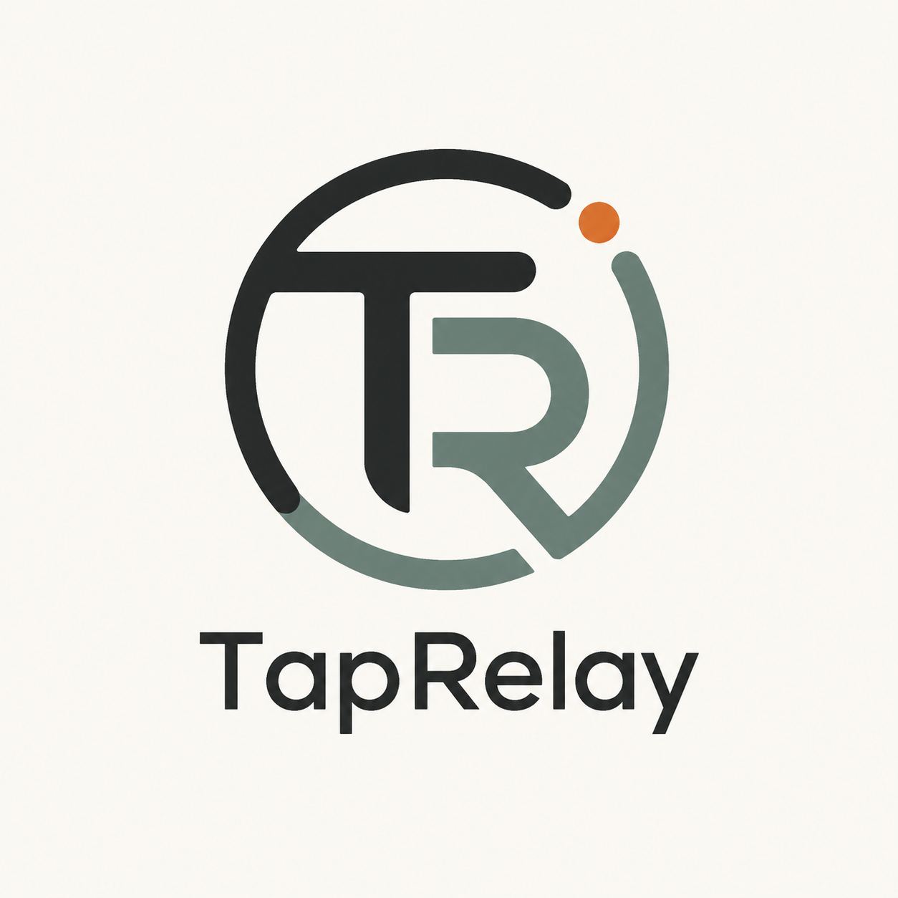
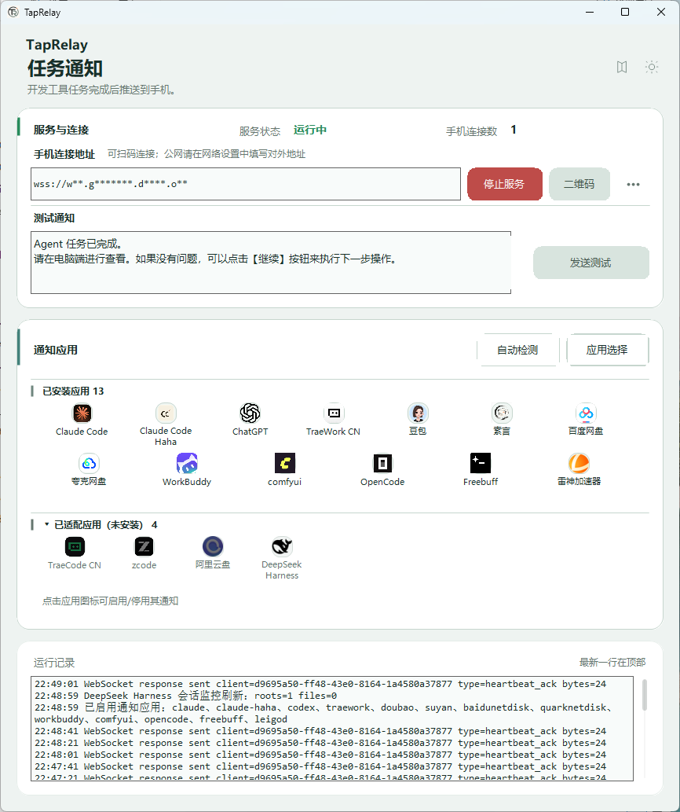
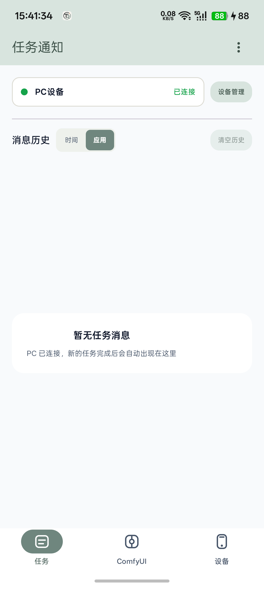
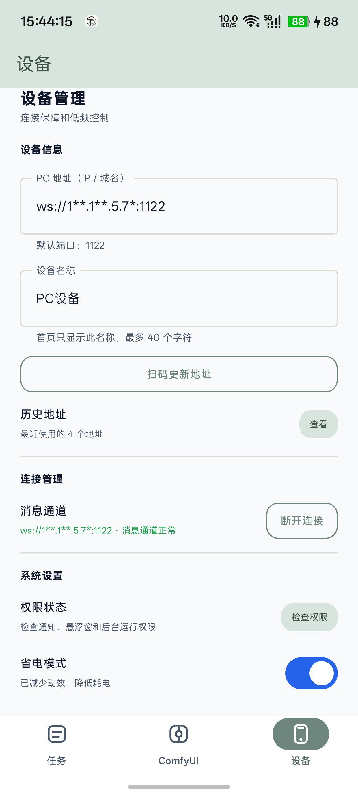
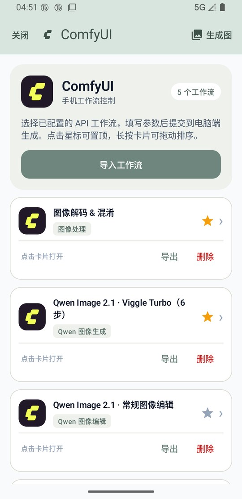
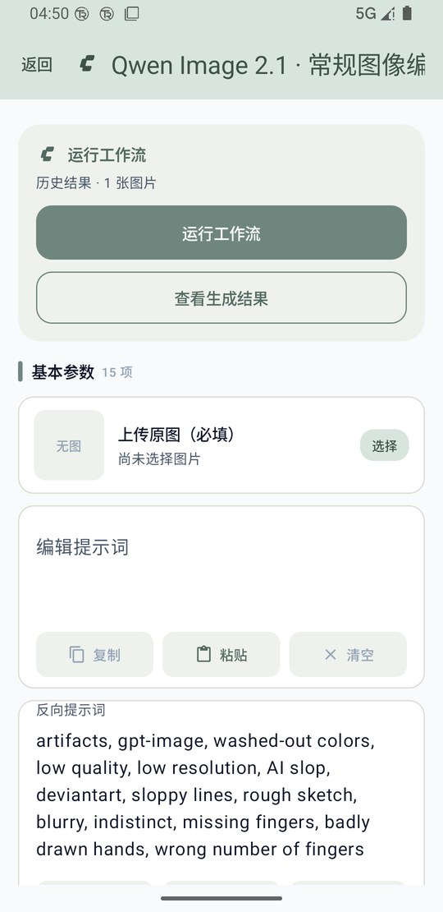
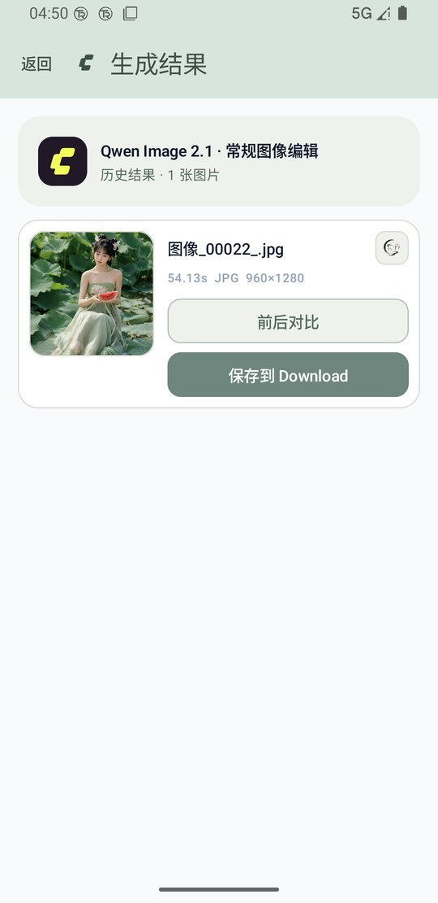
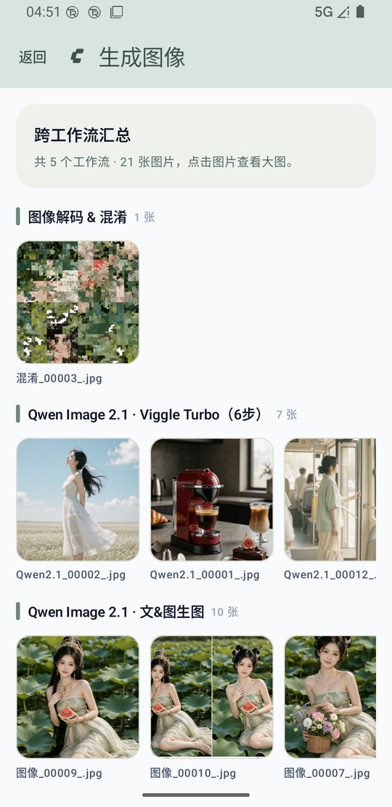

# TapRelay



**Push AI task status from a Windows PC to Android, with mobile ComfyUI workflow control.**

[中文 README](./README.md)

## Features

- Built-in HTTP / WebSocket relay for completed, failed, and waiting task events.
- Android message history with approval, stop, dismiss, address masking, and permission management.
- Select, configure, run, preview, compare, and save ComfyUI workflows from Android.
- No accounts, cloud database, or third-party push service. The default relay port is `1122`.

## Screenshots

| PC | Android tasks | Android device |
| --- | --- | --- |
|  |  |  |

The Android screenshots use the current real-device layout; the address is masked.

### ComfyUI mobile control

| Workflows | Parameters | Results | Gallery |
| --- | --- | --- | --- |
|  |  |  |  |

The console listens on the PC loopback address. Phones still use TapRelay port `1122` and never need another LAN port. ComfyUI must be running locally, usually at `http://127.0.0.1:8188`.

## Quick start

### PC

```powershell
.\tools\package-pc.ps1
```

This builds, publishes, checks `http://127.0.0.1:1122/health`, and starts `TapRelay.exe`.

### Android

```powershell
.\tools\test-android.ps1 -JavaHome "C:\path\to\jdk-21.0.4"
adb install -r .\android-app\app\build\outputs\apk\debug\app-debug.apk
```

Open Android **Device**, scan the PC QR code or enter its LAN address. The PC and phone must be able to reach each other; do not enter the phone's own `127.0.0.1`.

### Send a notification

```powershell
$body = @{ message = "Task completed"; source = "example-agent"; status = "completed"; taskId = "demo-1" } |
  ConvertTo-Json -Compress
Invoke-RestMethod "http://127.0.0.1:1122/send" -Method Post `
  -ContentType "application/json; charset=utf-8" -Body $body
```

## Repository layout

```text
pc-app/       Windows WinForms app and production HTTP/WebSocket service
android-app/  Kotlin / Jetpack Compose client
notify-server Node.js protocol implementation and Vitest tests
tools/        build, packaging, and agent integration scripts
tests/        protocol, reliability, and end-to-end tests
assets/readme README screenshots
docs/         adapter reports and third-party notices
```

ComfyUI workflows live in [`pc-app/Assets/ComfyUIConsole/api_workflows`](./pc-app/Assets/ComfyUIConsole/api_workflows).

## Security boundary

The default transport has no authentication or encryption and is intended for a trusted LAN. Never expose port `1122` directly to the public Internet, and never put passwords, tokens, or private keys in task logs.

## Development checks

```powershell
dotnet build .\pc-app\TapRelay.csproj -c Debug
.\tools\test-android.ps1 -JavaHome "C:\path\to\jdk-21.0.4"
Push-Location .\notify-server; npm ci; npm test; Pop-Location
```

## Related projects

- [SuYan](https://github.com/guliacer/SuYan): archive and manage generated assets.
- [ComfyUI-GuliNodes](https://github.com/guliacer/ComfyUI-GuliNodes): ComfyUI nodes used by the bundled workflows.
