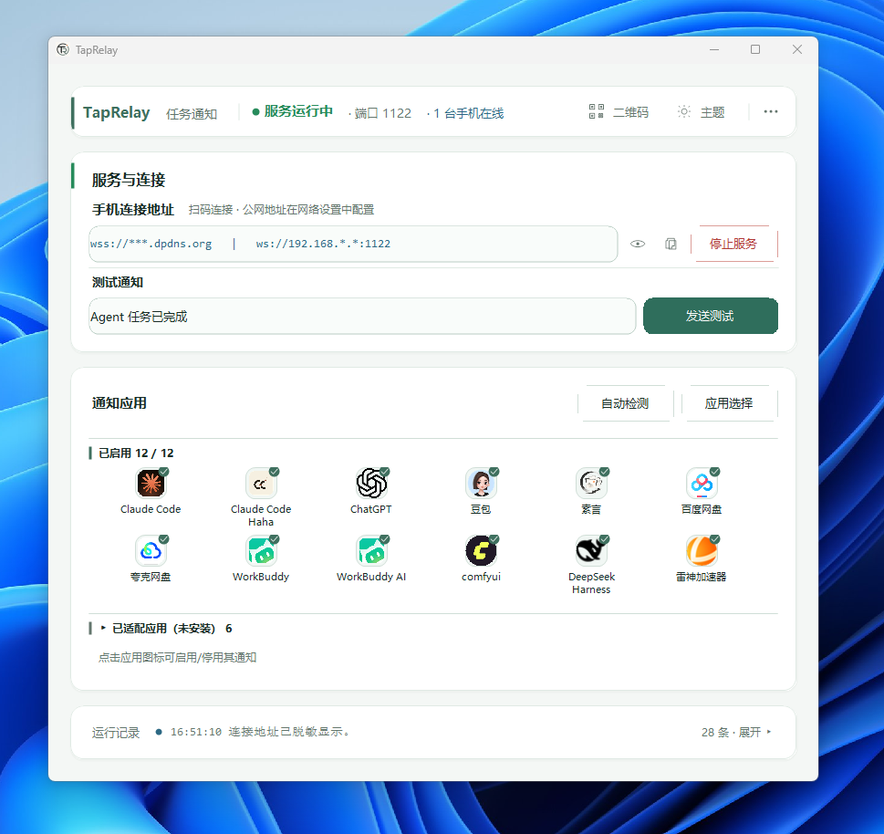
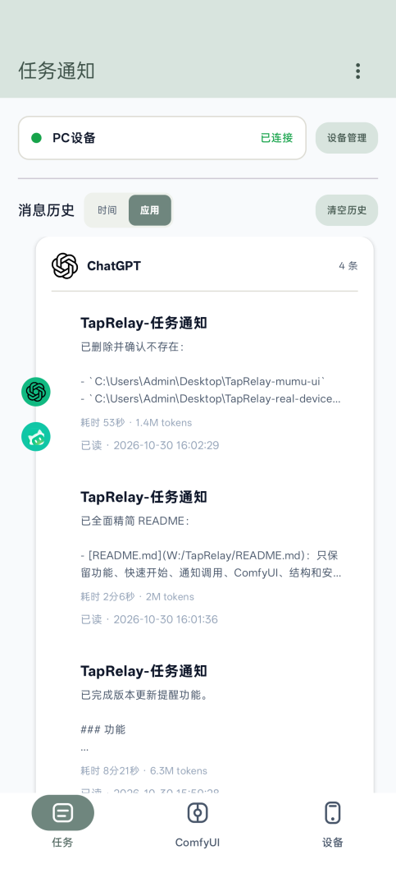
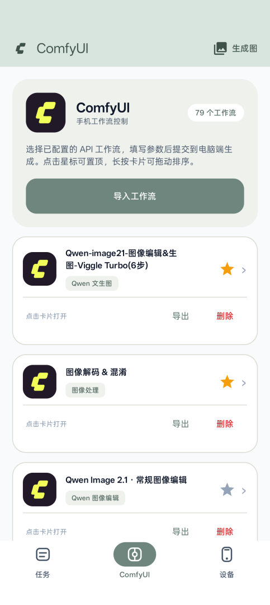
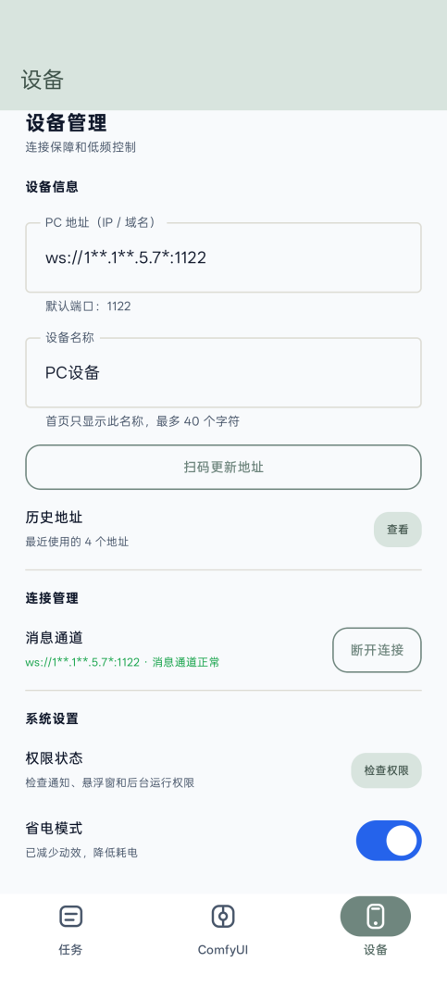

# TapRelay


**把 Windows PC 上的 AI 任务状态推送到 Android，并在手机上控制 ComfyUI。**

[English README](./docs/README.en.md)

## 项目预览

> 一眼看懂 TapRelay：PC 桌面端把 AI 任务状态实时推送到手机，手机端还能直接控制 ComfyUI 工作流。

| Windows 桌面端 | Android · 任务通知 |
| --- | --- |
|  |  |

| Android · ComfyUI 工作流 | Android · 设备管理 |
| --- | --- |
|  |  |

## 功能

- PC 内置 HTTP / WebSocket 服务，向 Android 推送完成、失败和待处理通知。
- Android 保存任务记录，支持审批、停止、清理、地址脱敏和设备管理。
- 手机选择 ComfyUI 工作流、填写参数、上传图片、运行并查看结果。
- 有新版本时，PC 和 Android 弹窗显示更新内容，可更新、跳过本次或永久跳过。
- 不需要账号、云数据库或第三方推送服务，默认使用 `1122` 端口。

## 最近更新

- 修复 Cloudflared 隧道边缘断连、手动进程管道阻塞和多公网候选错误覆盖，并在检查公网时等待真实重连结果。
- 完善 ComfyUI 原生工作流转 API：修复通配符输出与 Reroute 参数解析，新增 `.gg.json` 编组元数据 sidecar，并接入 API-only 工作流运行时回退。
- 补充 Cloudflared、ComfyUI 转换器和 API-only 编组元数据回归测试，完成发布版构建、启动健康检查与 28 个工作流转换验证。

## 快速开始

### PC

```powershell
.\tools\package-pc.ps1
```

启动后运行 `TapRelay.exe`。

### Android

```powershell
.\tools\test-android.ps1 -JavaHome "C:\path\to\jdk-21.0.4"
adb install -r .\android-app\app\build\outputs\apk\debug\app-debug.apk
```

打开 Android 的“设备”页面，扫码或填写 PC 局域网地址。

### 发送通知

```powershell
$body = @{ message = "任务已完成"; source = "example-agent"; status = "completed"; taskId = "demo-1" } |
  ConvertTo-Json -Compress
Invoke-RestMethod "http://127.0.0.1:1122/send" -Method Post `
  -ContentType "application/json; charset=utf-8" -Body $body
```

### ComfyUI

工作流放在 [`pc-app/Assets/ComfyUIConsole/api_workflows`](./pc-app/Assets/ComfyUIConsole/api_workflows)，PC 本机运行 ComfyUI 后即可从 Android 使用。

## 项目结构

```text
pc-app/       Windows 桌面端与内置服务
android-app/  Android 客户端
notify-server Node.js 协议服务与测试
tools/        构建、打包和接入脚本
tests/        自动化测试
docs/         报告与说明
```

## 安全

默认通信没有身份认证和加密，仅适合可信局域网；不要把 `1122` 直接暴露到公网。

## 开发验证

```powershell
dotnet build .\pc-app\TapRelay.csproj -c Debug
.\tools\test-android.ps1 -JavaHome "C:\path\to\jdk-21.0.4"
Push-Location .\notify-server; npm ci; npm test; Pop-Location
```

## 相关项目

- [SuYan](https://github.com/guliacer/SuYan)
- [ComfyUI-GuliNodes](https://github.com/guliacer/ComfyUI-GuliNodes)
