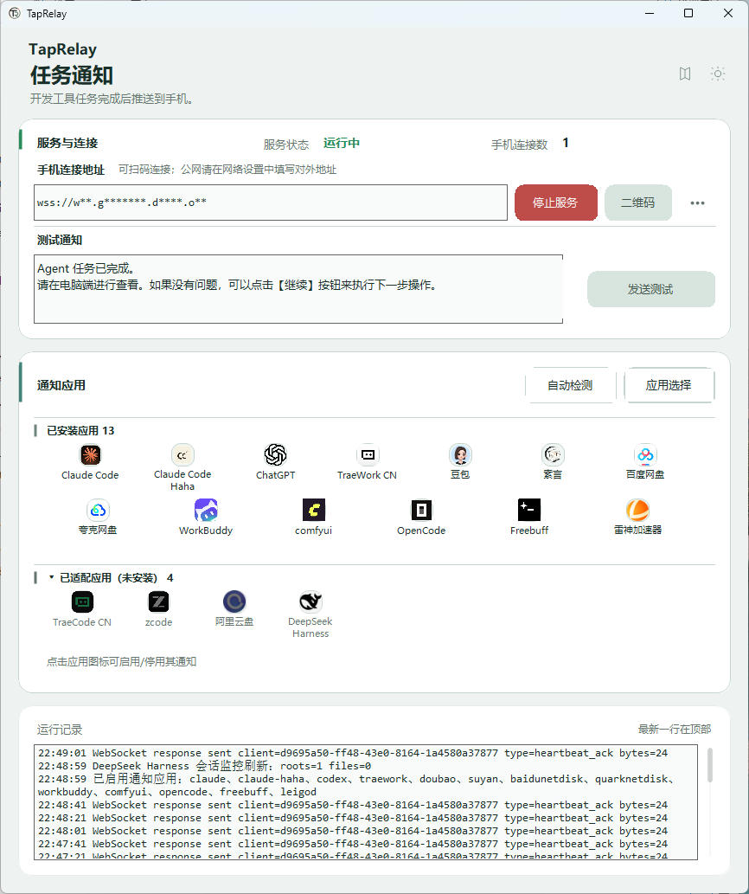
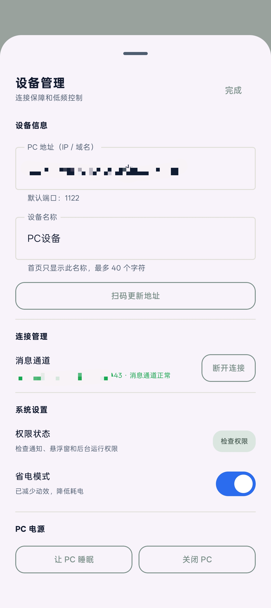
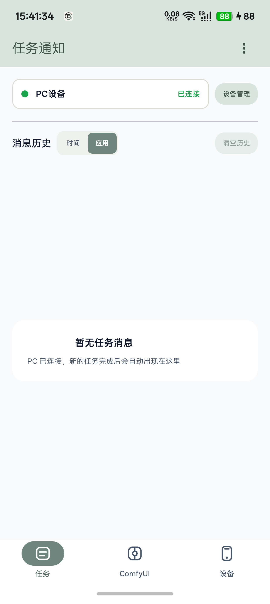
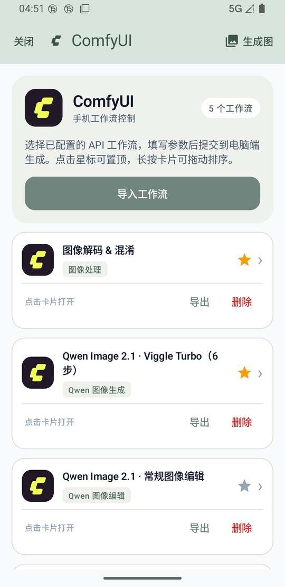
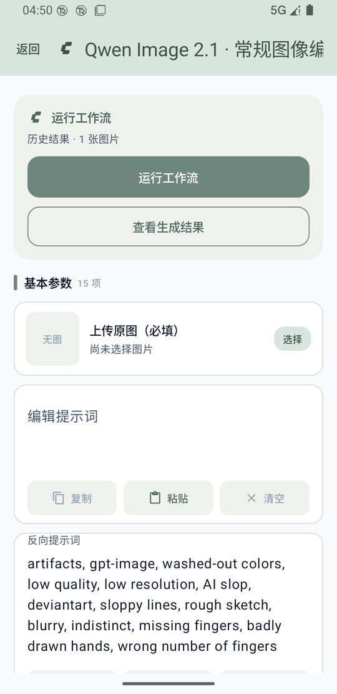
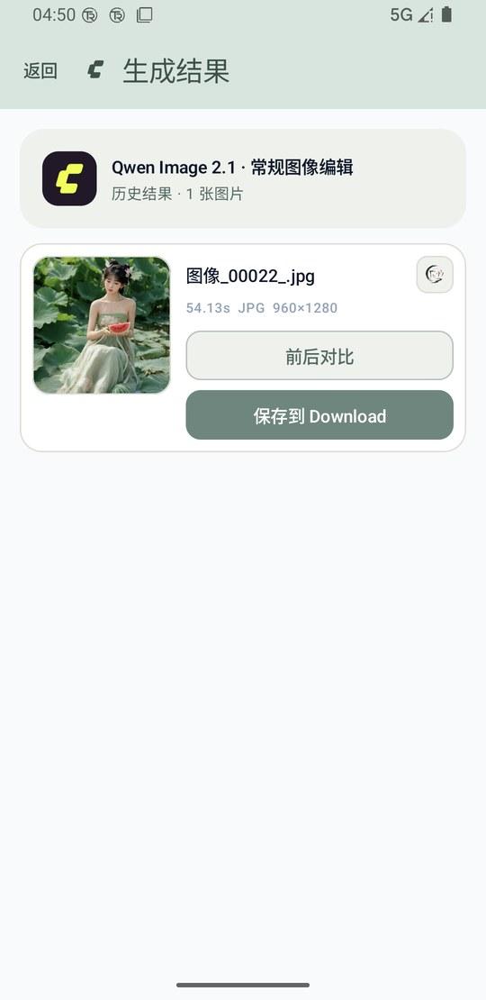
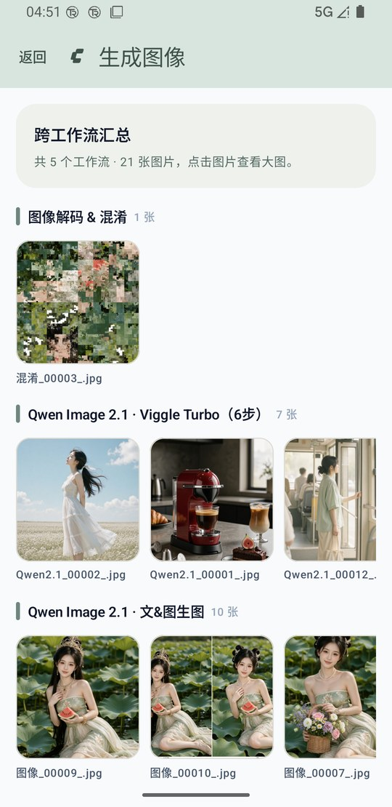

<div align="center">


# TapRelay

**把 PC 上的 AI 任务状态，直接送到 Android 手机。**

中文文档（当前页） | [English (optional)](./README.en.md)

<p><strong>致谢</strong>：ComfyUI 手机控制功能基于 <a href="https://github.com/Zizzp0318/ComfyUI-MobileConsole">ComfyUI-MobileConsole</a> 完善，感谢原项目作者。</p>

</div>

## 项目概览

<div align="center">
<table>
  <tr>
    <td align="center" valign="top">
      
      <br />
      <sub>PC 端：管理通知服务、应用适配和任务运行日志</sub>
    </td>
    <td align="center" valign="top">
      
      <br />
      <sub>Android 端：配置设备并接收 PC 任务通知</sub>
    </td>
  </tr>
</table>
</div>

TapRelay 是一套本地优先的任务通知中继：Windows PC 上的 AI Agent、桌面工具或脚本将完成、失败、等待处理等事件发送给 TapRelay；TapRelay 再通过局域网 WebSocket 推送至 Android 手机。它不要求账号、云端数据库或第三方推送服务。

> 默认链路仅适用于可信局域网：`Agent / Hook / 本地日志 -> TapRelay PC -> Android`。通信默认没有身份认证和传输加密，禁止把端口 `1122` 直接暴露到公网。

## 界面预览

<div align="center">
  
  <br />
  <sub>Android 消息历史：查看已推送的任务状态和任务日志</sub>
</div>

截图来自当前 PC 程序和 Android 模拟器的真实连通测试。PC 截图中的连接地址已脱敏；Android 截图使用模拟器地址 `10.0.2.2`。

## ComfyUI 手机工作流控制

除任务通知外，TapRelay 还在现有 `1122` 端口内提供 ComfyUI 手机控制页。Android 选择已配置的 API 工作流、填写参数并提交后，PC 端会把请求转给随 TapRelay 生命周期启动的控制台，再由它调用本机 ComfyUI。控制台只监听 `127.0.0.1`，手机不会看到额外端口；管理页 `/comfy/admin` 与 `/comfy/api/admin/*` 只接受 PC 本机回环请求。

<div align="center">
<table>
  <tr>
    <td align="center" valign="top">
      
      <br />
      <sub>工作流列表：星标置顶、拖动排序与导入 / 导出 / 删除</sub>
    </td>
    <td align="center" valign="top">
      
      <br />
      <sub>参数页：按 `.ui.json` 自动生成面板，支持提示词与图片字段</sub>
    </td>
  </tr>
  <tr>
    <td align="center" valign="top">
      
      <br />
      <sub>结果页：历次结果、用时 / 分辨率、前后对比与保存</sub>
    </td>
    <td align="center" valign="top">
      
      <br />
      <sub>生成图：跨工作流汇总本机暂存结果</sub>
    </td>
  </tr>
</table>
</div>

- **工作流管理**：内置 Qwen Image 2.1 系列（文&图生图、常规图像编辑、高分局部编辑、Viggle Turbo）与「图像解码 & 混淆」；支持导入、导出、删除、星标置顶和长按拖动排序。
- **参数面板**：按工作流的 `.ui.json` 生成中文参数；提示词支持复制、粘贴和清空；图片字段支持上传、缩略图预览与清除；LoRA 支持多槽位和自定义强度；局部编辑内置全屏蒙版画笔。
- **运行与结果**：运行按钮显示已消耗时长并可停止；结果按历次累积（每个工作流最多 50 条），支持多保存节点分页、前后对比滑杆、全屏预览、保存到 `Download/ComfyUI`，以及经 PC 转发到素言。
- **标题交互**：顶栏工作流名称自动循环滚动以完整显示，双击标题即可重命名；名称会持久化，重启和升级后不会丢失。
- **生成图汇总**：列表顶栏的「生成图」按工作流分组汇总本机暂存图片，点击可查看大图。

ComfyUI 功能要求 PC 本机已运行 ComfyUI（默认 `http://127.0.0.1:8188`），API 工作流由控制台管理。控制台程序位于 `pc-app/Assets/ComfyUIConsole`，内置工作流文件已随仓库发布：[pc-app/Assets/ComfyUIConsole/api_workflows](./pc-app/Assets/ComfyUIConsole/api_workflows)。

## 它能做什么

- PC 桌面端启动内置 HTTP / WebSocket 服务，固定监听端口 `1122`。
- Android 前台服务维持 WebSocket 连接，断开后自动重连，并将最近 100 条消息保存在本机。
- 连接成功后自动记录使用过的地址；「设备管理」里可查看最近 10 条（按最近使用倒序）并直接选用，换网络或换 PC 后不必重新手输。
- 任务卡片优先展示生产者提供的真实 `taskLog`，而不是“任务已完成”之类的通用文案。
- 支持系统通知、消息历史、可选悬浮卡片、全屏提醒，以及设备名称和主题设置。
- 手机端不提供继续会话或发送新指令入口；需要续接时请直接在电脑端对应应用中操作。
- 支持任务状态、审批事件与本地自定义应用图标注册；未知来源仍可作为普通 TapRelay 消息接收。
- 在同一 `1122` 端口内提供 ComfyUI 手机控制页：选择工作流、填写参数、上传图片、运行并查看或保存结果。

```text
Claude / Codex / Trae / 脚本 / 其他本地工具
                    |
                    | HTTP POST http://127.0.0.1:1122/send
                    v
              TapRelay PC
                    |
                    | WebSocket ws://<PC-LAN-IP>:1122
                    v
             TapRelay Android
          通知 / 历史 / 悬浮卡片
```

## 组成与要求

| 组件 | 作用 | 运行要求 |
| --- | --- |
| `pc-app` | Windows WinForms 桌面端和正式通知服务 | Windows 10/11 x64 |
| `android-app` | Kotlin / Compose Android 客户端 | Android 8.0（API 26）或更高 |
| `notify-server` | 独立 Node.js 协议实现和自动化测试入口，不是日常必启服务 | Node.js 24.13.0、npm 11.6.2 |
| `tools` | 打包、Android 验证及 Agent 接入脚本 | 视所用脚本而定 |

开发环境使用 .NET SDK 3.1.426、JDK 21.0.4 和项目自带 Gradle Wrapper。PC 与 Android 必须可在同一局域网互相访问；手机填写的是 PC 的局域网 IP 或主机名，而不是 `127.0.0.1`。

## 快速开始

### 1. 生成并启动 PC 端

```powershell
.\tools\package-pc.ps1
```

脚本会构建、发布、验证 `http://127.0.0.1:1122/health`，并启动 `pc-app\publish\TapRelay.exe`。之后也可以直接运行该 EXE。

打开 PC 端后，确认服务状态为“运行中”，再通过二维码或界面中的局域网地址连接手机。Windows 防火墙需要允许 TapRelay 在专用网络通信。

### 2. 构建并安装 Android 端

```powershell
.\tools\test-android.ps1 -JavaHome "C:\path\to\jdk-21.0.4"
adb install -r .\android-app\app\build\outputs\apk\debug\app-debug.apk
```

打开 Android 应用后，在“设备管理”中扫码或填写 PC 地址。默认端口固定为 `1122`，不需要也不能在手机端修改。建议按“检查权限”完成通知、后台运行和所需的悬浮窗授权；悬浮卡片和全屏提醒属于可选能力。

### 3. 发送一条真实测试消息

```powershell
$body = @{
  message = "已完成局域网连接演示。"
  taskLog = "已完成局域网连接演示。`nPC 通过 WebSocket 将真实任务结果推送到 Android。"
  source = "taprelay"
  status = "completed"
  taskId = "readme-smoke-test"
} | ConvertTo-Json -Compress

Invoke-RestMethod -Uri "http://127.0.0.1:1122/send" `
  -Method Post -ContentType "application/json; charset=utf-8" `
  -Body ([Text.Encoding]::UTF8.GetBytes($body))
```

响应中的 `clients`（或 PC 正式端的 `sentClients`）大于 `0`，并且手机出现新消息，才表示本次消息已发送给在线设备。服务端不保存离线待发消息。

## 接入任务来源

所有来源最终都应调用 `POST http://127.0.0.1:1122/send`。新接入必须提供真实任务结果、错误详情或等待问题，不能把用户提示词、会话标题或通用状态模板伪装成任务日志。

### 内置来源

下表说明当前 PC 程序内置的识别和监控通道。第三方工具的本地数据格式、窗口结构和 API 会随版本变化，因此“已内置”不表示每个版本均已完成实机验证；生产使用前应在自己的环境中发送一轮完成、失败和等待事件进行确认。

| 来源 | 本地状态 / 日志通道 |
| --- | --- |
| Claude Code | 官方 Hook 与本地会话信息 |
| Claude Code Haha | sidecar 本地事件 |
| Codex / ChatGPT | 本地 Codex 会话记录 |
| TraeCode CN、TraeWork CN | 本地渲染器日志 |
| ZCode | CLI / 桌面端本地日志 |
| 豆包 | 本地完成请求日志与当前会话内容 |
| WorkBuddy | 本地会话数据与 ACP 事件 |
| OpenCode | 本地 `opencode.db` |
| DeepSeek Harness | 本地会话记录 |
| Freebuff | 本地数据库与 orchestrator 事件 |
| ComfyUI、网盘等工具 | 应用自身的本地工作流或任务状态 |

手机端通知卡片只提供查看、处理审批、停止任务和关闭等操作，不提供继续会话按钮。任务最终状态以应用产生的真实日志或事件为准。

### Claude Code 与 Codex CLI 安装脚本

```powershell
# 仅安装 Claude Code Hook
powershell.exe -NoProfile -ExecutionPolicy Bypass `
  -File ".\tools\install-ai-notify.ps1" -ClaudeOnly

# 仅安装 Codex / ChatGPT notify 配置
powershell.exe -NoProfile -ExecutionPolicy Bypass `
  -File ".\tools\install-ai-notify.ps1" -CodexOnly
```

其他能在任务结束时执行命令的工具，可调用统一脚本：

```powershell
powershell.exe -NoProfile -ExecutionPolicy Bypass `
  -File ".\tools\ai-complete-notify.ps1" `
  -Source "my-agent" -Status "completed" `
  -Message "已生成报告并通过校验"
```

更详细的 Hook、路径和本地监听说明见 [tools/README-agent-integrations.md](./tools/README-agent-integrations.md)。

## 通信接口

### 健康检查

```http
GET http://127.0.0.1:1122/health
```

```json
{
  "status": "ok",
  "port": 1122,
  "clients": 1
}
```

### 发送任务通知

```http
POST http://127.0.0.1:1122/send
Content-Type: application/json
```

```json
{
  "message": "已完成鉴权模块重构并通过 12 项测试",
  "taskLog": "已完成鉴权模块重构并通过 12 项测试\n变更：...\n验证：...",
  "source": "example-agent",
  "status": "completed",
  "taskId": "native-task-id",
  "sessionId": "original-session-id",
  "cwd": "W:\\project",
  "projectName": "project",
  "durationMs": 125900,
  "tokenCount": 42850
}
```

| 字段 | 是否必填 | 说明 |
| --- | --- | --- |
| `message` | 是 | 简短且真实的摘要，去首尾空白后最多 500 个字符 |
| `taskLog` | 强烈建议 | 完成结果、错误详情或等待问题；保留换行和缩进，最多 4000 个 UTF-16 单元 |
| `source` | 新接入建议必填 | ASCII 来源键，例如 `claude`、`codex`、`opencode` |
| `status` | 新接入建议必填 | `completed`、`failed` 或 `waiting` |
| `taskId` | 新接入建议必填 | 原生任务 / 回合 ID，用于去重 |
| `sessionId` | 可选 | 来源原生会话 ID；仅在来源需要时发送 |
| `cwd`、`projectName` | 可选 | 实际工作目录和项目名，用于归属与显示 |
| `durationMs`、`tokenCount` | 可选 | 仅在来源提供可信数据时发送；未知时传 `0` 或省略 |

`POST /events` 用于实时生命周期和审批事件；`GET /apps`、`POST /apps/register`、`GET /apps/icon/<appKey>` 用于同步本机注册的自定义应用元数据和图标。旧客户端仍可接收 `type="message"` 的 WebSocket 通知。

ComfyUI 手机页通过 `/comfy/*` 访问 PC 端控制台，其中 `/comfy/api/mobile/*` 提供工作流导入、导出、删除、改名、LoRA 候选、遮罩合成和素言转发等手机专用接口。控制台由 TapRelay 自动启动并只监听本机回环地址；`/comfy/admin` 与 `/comfy/api/admin/*` 仅限 PC 本机访问。

## 数据与权限边界

- Android 只使用本机 `SharedPreferences` 保存连接配置、最近 10 条连接地址（`host_history`）和最近 100 条消息；PC 服务只在内存中维护在线连接，不提供离线补发。
- Android 设备名称默认是“PC设备”，可以在设备管理中修改；首页展示名称而非 IP 地址。
- 开启「隐藏地址」后，地址栏、状态行、历史地址列表与系统通知里的地址都会脱敏；清空历史地址不会影响当前连接配置。
- ComfyUI 结果索引与图片保存在 Android 私有目录（`files/ComfyUI`，每个工作流最多 50 条）；写入 `Download/ComfyUI` 或分享到素言都需要手动触发。工作流、参数、遮罩和转发请求都经 PC 的 `1122` 回环代理，`/comfy/admin` 与 `/comfy/api/admin/*` 不对手机开放。
- 通知、相机扫码、悬浮窗、后台运行 / 电池优化和厂商自启动权限应按实际需要授予。拒绝悬浮窗权限时，应用退化为普通系统通知。
- TapRelay 不应传输密码、令牌、私钥或完整敏感命令参数。`taskLog` 和审批摘要同样应先完成脱敏。
- 不要使用端口映射、开放公网防火墙或未受保护的反向代理暴露 `1122`。本项目不提供账号体系、云端消息存储或公网推送。

## 开发与验证

```powershell
# PC 源码编译
dotnet build .\pc-app\TapRelay.csproj -c Debug

# PC 实时协议回归
dotnet run --project .\tests\TapRelay.Protocol.Tests\TapRelay.Protocol.Tests.csproj -c Debug

# Android 单元测试、Debug 构建和 Lint
.\tools\test-android.ps1 -JavaHome "C:\path\to\jdk-21.0.4"

# Node.js 独立协议服务测试
Push-Location .\notify-server
npm ci
npm test
Pop-Location
```

本文档的通知截图在 2026-09-12 通过当前 `pc-app\publish\TapRelay.exe`、端口 `1122`、Android 模拟器和真实 `POST /send` 流程生成；ComfyUI 截图在 2026-10-23 由同一模拟器连接本机 ComfyUI 后实拍。它们验证了 PC 服务健康检查、WebSocket 连接、Android 接收链路和 ComfyUI 工作流控制，但不替代对每一个第三方 Agent 版本或工作流的实机验收。

## 项目结构

```text
TapRelay/
├─ pc-app/          # WinForms 桌面端、内置 HTTP/WebSocket 服务、应用适配器
│  └─ Assets/ComfyUIConsole/ # 随包 ComfyUI 控制台与内置 API 工作流
├─ android-app/     # Kotlin / Jetpack Compose Android 客户端
├─ notify-server/   # Node.js 协议实现和 Vitest 测试
├─ tools/           # 打包、构建与 Agent 接入脚本
├─ tests/           # PC 协议、可靠性和端到端测试
├─ assets/readme/   # README 使用的真实界面截图
├─ docs/            # 适配报告和测试记录
└─ NN-*.md          # 项目规则与问题记录
```

## 常见问题

**手机无法连接 PC？** 确认二者位于同一可互访网络，Android 中填写的是 PC 的局域网 IP / 主机名，PC 服务处于运行中，且 Windows 防火墙允许端口 `1122`。访客网络和 AP 隔离会阻断设备互访。

**锁屏后没有提醒？** 先确认 Android 消息历史是否已经收到该条消息；若已收到但无横幅或全屏提示，请检查系统通知权限、通知渠道重要性、电池优化和厂商后台限制。悬浮卡片需要额外授予悬浮窗权限。

**需要单独启动 Node.js 服务吗？** 不需要。日常使用由 `TapRelay.exe` 内置服务监听 `1122`；`notify-server` 用于协议开发和自动化测试。

## 配套项目推荐

以下项目与 TapRelay 搭配使用更顺手：

- [SuYan（素言）](https://github.com/guliacer/SuYan) —— 本地素材管理软件。ComfyUI 生成结果可经 PC 直接发送到素言收件服务，生成后即可归档、检索和复用。
- [ComfyUI-GuliNodes](https://github.com/guliacer/ComfyUI-GuliNodes) —— ComfyUI 自定义节点插件。内置 Qwen Image 与图像解码&混淆工作流依赖其中的 `GGImageComparer2`、`GGImageCompressSave`、`GGLoRACustomLoader`、`GGImageObfuscate` 等节点，使用前请先在 ComfyUI 中安装。

## 反馈

提交问题时请说明 PC 与 Android 版本、消息来源、复现步骤、期望与实际结果，并附上脱敏后的 PC 运行日志或 Android `logcat` 片段。不要上传令牌、密码、私钥或完整敏感任务内容。
