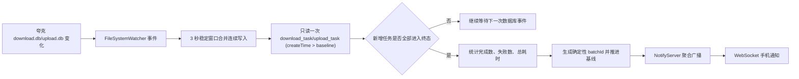

# 夸克网盘批量任务结束通知适配报告

- 项目：TapRelay
- 报告日期：2026-08-01
- 本机夸克网盘安装目录：`C:\Program Files (x86)\QuarkCloudDrive`
- 本机已验证客户端版本：`6.5.5.724`

## 1. 结论摘要

夸克网盘未公开提供 Windows 桌面客户端的下载/上传队列聚合回调 API。TapRelay 采用与百度网盘一致的事件驱动替代方案：监听夸克网盘 SQLite 任务库文件变更，在队列稳定后读取一次队列聚合快照，并仅在整批任务进入终态时发送一条通知。

与百度网盘方案的关键差异：

| 维度 | 百度网盘 | 夸克网盘 |
|---|---|---|
| 任务表 | `download_file` + `download_history_file` 双表 | `download_task` / `upload_task` 单表常驻 |
| 完成判定 | 任务从 `download_file` 移入 `download_history_file` | `status` 字段翻转为 `FINISH` |
| 失败判定 | `error_code != 0` | `status` 含 FAIL/ERROR/CANCEL/EXCEPTION |
| 基线字段 | `task_id` / 历史 ID | `createTime` 高水位 |
| 方向覆盖 | 仅下载 | 下载 + 上传 |
| 数据库文件 | `BaiduYunGuanjia.db` 单库 | `download.db` + `upload.db` 双库 |
| 合成行 | 无 | `id=''` 的 MANAGER 聚合行（需排除） |
| 通知 source | `baidunetdisk` | `quarknetdisk`（下载）/ `quarknetdisk-upload`（上传） |

当前实现符合以下约束：

- 不发送单文件完成/失败通知；
- 不按固定周期逐任务轮询；
- 由 `FileSystemWatcher` 接收数据库文件变化事件；
- 同一批次最多生成一条聚合事件；
- 消息包含完成数、失败数和总耗时；
- 下载与上传各自独立监听、独立通知；
- 事件经 TapRelay 内置 NotifyServer/WebSocket 推送至 Android 手机端。

## 2. 本机数据库验证

夸克网盘将下载任务和上传任务分别存储在两个独立 SQLite 数据库中：

```text
%LOCALAPPDATA%\QuarkCloudDrive\User Data\persistence\<userId>\download.db
%LOCALAPPDATA%\QuarkCloudDrive\User Data\persistence\<userId>\upload.db
```

表结构（下载库与上传库结构对称）：

```sql
download_task(
  id TEXT PRIMARY KEY,       -- 任务 ID；id='' 为合成 MANAGER 行，需排除
  status TEXT,                -- RUNNING / FINISH / 失败态
  createTime INTEGER,         -- 任务创建时间（毫秒）
  finishTime INTEGER,         -- 任务完成时间（毫秒）
  updateTime INTEGER          -- 任务最后更新时间（毫秒）
)
```

关键发现：

- 夸克网盘不会在任务完成后将记录移出 `download_task`/`upload_task` 表，所有任务常驻；
- `status='RUNNING'` 表示进行中，`status='FINISH'` 表示成功完成；
- 失败/取消状态的精确取值未公开文档化，适配采用防御性匹配：任何包含 FAIL/ERROR/CANCEL/EXCEPTION 的状态值视为终态失败；
- `id=''` 的 MANAGER 行是队列状态聚合行，不是真实传输任务，必须在查询中排除。

## 3. TapRelay 适配实现

### 3.1 PC 事件监听

新增文件：

```text
W:\TapRelay\pc-app\QuarkNetdiskBatchMonitor.cs
```

该文件包含四个内部类型：

- `QuarkNetdiskBatchMonitor` — 监听器主体，管理 FileSystemWatcher 与稳定窗口
- `QuarkNetdiskDataLocator` — 数据库发现（注册表/进程/标准目录/显式环境变量）
- `QuarkNetdiskDatabaseReader` — 只读 SQLite 快照读取
- `QuarkBatchCompletion` / `QuarkDatabaseSnapshot` / `QuarkTaskRow` — 数据模型

处理链路：



数据库发现范围：

- `TAPRELAY_QUARK_DB` 显式测试路径（分号分隔，方向由文件名推断）；
- `%LOCALAPPDATA%\QuarkCloudDrive\User Data\persistence\<userId>\`；
- `%APPDATA%\QuarkCloudDrive\User Data\persistence\<userId>\`；
- Windows 卸载注册表中包含"夸克网盘/QuarkCloudDrive"的安装目录；
- 正在运行的 `QuarkCloudDrive.exe` 所在目录。

当 `TAPRELAY_QUARK_DB` 指向有效数据库时，监听器只使用显式数据库，避免测试误接入真实账户库。

### 3.2 触发条件

一次批次通知需要同时满足：

1. 数据库稳定窗口（3 秒）内无新写入；
2. 自基线 `createTime` 之后存在新增任务（`NewTasks.Count > 0`）；
3. 所有新增任务均已进入终态（`FINISH` 或失败态），无 `RUNNING` 任务；
4. 完成数与失败数之和大于 0；
5. 当前批次未被 `batchId` 防重逻辑处理过。

计数规则：

- 完成数：`NewTasks` 中 `status='FINISH'` 的任务数；
- 失败数：`NewTasks` 中 `status` 含 FAIL/ERROR/CANCEL/EXCEPTION 的任务数；
- 开始时间：`NewTasks.Min(createTime)`；
- 结束时间：`NewTasks.Max(finishTime > 0 ? finishTime : updateTime)`；
- 通知发出后，基线推进到全表 `MAX(createTime)`，确保同一组终态任务永不重复评估。

### 3.3 通知数据

下载完成示例：

```json
{
  "message": "夸克网盘批量下载结束：完成 12 个，失败 1 个，总耗时 18 分 32 秒",
  "source": "quarknetdisk",
  "status": "completed",
  "taskId": "quark-dl-<dbhash>-<startMs>-<endMs>-<completed>-<failed>",
  "cwd": ""
}
```

上传完成示例：

```json
{
  "message": "夸克网盘批量上传结束：完成 5 个，失败 0 个，总耗时 3 分 12 秒",
  "source": "quarknetdisk-upload",
  "status": "completed",
  "taskId": "quark-ul-<dbhash>-<startMs>-<endMs>-<completed>-<failed>",
  "cwd": ""
}
```

当完成数为 0 且失败数大于 0 时，`status` 为 `failed`。

### 3.4 PC 端集成

修改文件：

```text
W:\TapRelay\pc-app\AgentCompletionMonitor.cs      — 实例化并启停监听器，DispatchQuarkBatch 转发事件
W:\TapRelay\pc-app\NotificationAppsPanel.cs         — 自动检测夸克网盘，面板显示与应用密钥推断
```

启动日志示例：

```text
已启用 Claude/Codex/Trae/Trae SOLO/ZCode/豆包/百度网盘/夸克网盘 完成事件监控
已启用夸克网盘批量任务结束监听（数据库变更事件驱动，不逐任务轮询）：下载库 1 个，上传库 1 个
```

## 4. Android 适配

### 4.1 通知渠道

新增独立夸克网盘通道：

| 配置项 | 值 |
|---|---|
| Channel ID | `quarknetdisk_batches_v1` |
| Channel Name | `夸克网盘` |
| Description | `夸克网盘批量下载/上传任务结束通知` |
| Importance | `IMPORTANCE_HIGH` / 4 |
| 项目颜色 | `#4E6EF2`（蓝紫，与 PC 端面板配色一致） |
| 大图标 | `ic_quarknetdisk_logo.png`（256×256 彩色，从安装目录 Logo.png 提取） |
| 状态栏小图标 | `ic_stat_quarknetdisk.png`（96×96 白色剪影） |

### 4.2 渠道归并

下载与上传使用不同 `source`（`quarknetdisk` / `quarknetdisk-upload`），但在 Android 端归并到同一 `Channel.QuarkNetdisk` 枚举，使用同一品牌色和同一通知通道，便于统一图标显示与项目分组。

### 4.3 修改文件

```text
W:\TapRelay\android-app\app\src\main\java\com\lan\notify\data\Channel.kt
W:\TapRelay\android-app\app\src\main\java\com\lan\notify\ui\theme\Color.kt
W:\TapRelay\android-app\app\src\main\java\com\lan\notify\notification\NotificationHelper.kt
W:\TapRelay\android-app\app\src\main\java\com\lan\notify\ui\MainScreen.kt
W:\TapRelay\android-app\app\src\main\res\drawable-nodpi\ic_quarknetdisk_logo.png
W:\TapRelay\android-app\app\src\main\res\drawable-nodpi\ic_stat_quarknetdisk.png
W:\TapRelay\android-app\app\src\test\java\com\lan\notify\data\ChannelTest.kt
```

## 5. 防误触发与防重复

1. **启动基线**：启动时记录全表 `MAX(createTime)` 作为基线，不把旧任务当作新批次通知。
2. **3 秒稳定窗口**：连续数据库写入被合并，避免队列尚未完全落库时提前通知。
3. **整队列终态判断**：仍存在 `RUNNING` 任务时不通知，继续等待下一次数据库事件。
4. **MANAGER 行排除**：查询 `WHERE id != ''`，排除合成聚合行。
5. **基线推进**：通知发出后基线推进到全表 `MAX(createTime)`，同一组终态任务永不重复评估。
6. **确定性批次 ID**：数据库路径哈希、方向前缀、开始时间、结束时间、完成数、失败数共同构成 `batchId`。
7. **NotifyServer 二次防重**：服务端按 `source + status + taskId` 再次拒绝重复事件。

## 6. 测试结果

### 6.1 PC 合成 SQLite 队列测试

测试项目：

```text
W:\TapRelay\tests\TapRelay.QuarkMonitor.Tests
```

| 场景 | 预期 | 结果 |
|---|---|---|
| 下载：1 完成 + 1 失败 | 单条聚合通知，完成 1、失败 1、耗时 60ms、source=quarknetdisk | 通过 |
| 下载：2 全部失败 | 单条聚合通知，完成 0、失败 2、状态 failed、耗时 42ms | 通过 |
| 下载：2 全部完成后同一终态任务再次写库 | 不重复通知 | 通过 |
| 上传：1 完成 | 单条聚合通知，Direction=Upload、source=quarknetdisk-upload、消息含"上传" | 通过 |

结果：`4 passed, 0 failed`。

### 6.2 构建验证

| 构建 | 结果 |
|---|---|
| PC `TapRelay.csproj` Release 构建 | 成功，0 error，2 个既有 nullable warning（非本次引入） |
| Android `assembleDebug` | 成功 |
| Android `testDebugUnitTest`（ChannelTest） | 成功 |

### 6.3 尚未完成的真实夸克任务验收

合成数据库测试已覆盖核心逻辑，但还需在夸克网盘 UI 中手动发起真实下载/上传批次完成端到端验收：

1. 启动打包后的 TapRelay；
2. 确认手机已连接；
3. 在夸克网盘一次选择 2-3 个小文件形成一批下载；
4. 等待全部完成，验证手机只收到一条夸克网盘聚合下载通知；
5. 同样验证上传批次；
6. 验证失败/取消场景的真实 `status` 取值是否与防御性匹配一致。

## 7. 兼容性边界与风险

1. 本机真实验证版本是 `6.5.5.724`，夸克网盘更新频率较高，后续版本可能调整数据库结构。
2. 当前方案依赖本地数据库表名及字段：`download_task`/`upload_task`、`id`、`status`、`createTime`、`finishTime`、`updateTime`。
3. 失败状态的精确取值未公开文档化，适配采用防御性匹配（含 FAIL/ERROR/CANCEL/EXCEPTION 即视为失败）。若夸克使用不含这些关键字的其他失败状态名，该任务会被视为"仍在进行中"而延迟通知，但不会伪造成功通知。
4. 如果后续版本改变数据库路径、表名、字段或引入加密，监听器会记录接入/解析错误，而不是静默伪造成功通知。

## 8. 部署步骤

### 8.1 PC 端

1. 构建打包：

```powershell
dotnet publish w:\TapRelay\pc-app\TapRelay.csproj -c Release -r win-x64 --self-contained
```

2. 运行 `TapRelay.exe`，确认日志中出现"已启用夸克网盘批量任务结束监听"；
3. 在通知应用面板点击"自动检测"，确认夸克网盘图标出现；
4. 如未自动检测到，确认夸克网盘已登录并至少创建过一次下载/上传任务（数据库文件需存在）。

### 8.2 Android 端

1. 构建安装：

```powershell
.\gradlew.bat assembleDebug
adb install -r app\build\outputs\apk\debug\app-debug.apk
```

2. 打开 TapRelay App，连接到 PC 端 WebSocket；
3. 在手机通知设置中确认"夸克网盘"通道存在且重要性为"高"。

### 8.3 端到端验证

1. 在夸克网盘中选择 2-3 个小文件发起下载；
2. 等待全部完成后，手机应收到一条通知：`夸克网盘 • 完成 — 夸克网盘批量下载结束：完成 N 个，失败 0 个，总耗时 ...`；
3. 同样验证上传批次，通知应为"夸克网盘批量上传结束"。

## 9. 验收结论

| 项目 | 当前状态 |
|---|---|
| 事件驱动替代方案 | 完成 |
| 下载完成监听 | 完成 |
| 上传完成监听 | 完成 |
| 禁止逐任务通知 | 满足 |
| 禁止固定周期逐任务轮询 | 满足 |
| 完成数/失败数/总耗时 | 完成 |
| PC 合成测试 | 通过（4/4） |
| Android 独立通道及图标 | 完成 |
| Android 编译与单元测试 | 通过 |
| 本机真实下载批次 | 待用户在夸克网盘中发起小文件批次 |
| 本机真实上传批次 | 待用户在夸克网盘中发起小文件批次 |
| 本机真实失败/取消批次 | 待用户提供可控失败场景 |

## 10. 修订记录（2026-08-03 全面适配复核，详见 09-问题与优化记录-内容.md P050）

- 真实端到端已双向验证：下载（2026-08-01 两批）与上传（2026-08-03，6 完成 0 失败）均实测广播成功。
- 状态语义修正：CANCEL/DELETE 改判为「用户取消」，不再计入失败、全取消批次不发通知（对齐全项目「用户取消不告警」语义）；新增 PAUSE/STOP/SUSPEND 暂停态识别，暂停任务跳过、不阻塞批次，baseline 只按终态推进；移除「未知终态伪造为完成」的防御分支。
- 开关修正：`quarknetdisk-upload` 纳入 NotifyServer 来源开关，与 `quarknetdisk` 共用面板启用/禁用状态。
- 测试扩充：合成 SQLite 测试由 4 项增至 7 项（新增全取消不通知、暂停不阻塞、混合批次取消排除），7/7 通过。

## 11. 进程门控修订（2026-08-05）

- 夸克数据库文件属于持久化历史数据，即使客户端退出，文件也可能因 WAL/checkpoint 或后台文件操作发生变化；仅凭文件变化不能判断夸克正在使用。
- 监控器与 `tools/watch-adapted-processes.ps1` 使用相同进程名（`quark_cloud_drive`、`QuarkCloudDrive`）。未检测到进程时不发现数据库、不创建 `FileSystemWatcher`、不轮询文件，也不发送夸克任务通知。
- 检测到进程退出时立即清理数据库 watcher 和待处理稳定计时器；数据库读取前、通知发送前再次校验进程，丢弃退出后的异步回调。
- 夸克重新启动后重新建立数据库 baseline，避免把历史已完成任务重复通知。夸克监控测试现为 `11/11` 通过，PC Release 构建为 0 警告、0 错误。
