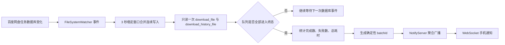

# 百度网盘批量下载结束通知适配报告

- 项目：TapRelay
- 报告日期：2026-07-31
- 本机百度网盘安装目录：`D:\Program Files\BaiduNetdisk`
- 本机已验证客户端版本：`7.0.6.11`
- 官方版本页在 2026-07-31 显示的最新 Windows 版本：`8.6.8.102`（发布时间 2026-07-28）

## 1. 结论摘要

截至 2026-07-31，本次检索未发现百度网盘开放平台公开提供 Windows 桌面客户端本地下载队列的 `allTaskComplete`、`batchDownloadFinished`、`taskQueueAllDone`、`QueueState.COMPLETED` 或 `QueueState.FAILED` 等聚合回调。这些名称不能作为真实的百度官方 API 使用。

百度开放平台公开能力主要面向 OAuth、云端文件管理、上传、下载、搜索、用户信息以及 Android/iOS 等 SDK；官方文档目录中未发现 Windows 桌面客户端本地任务队列监听 SDK。因此 TapRelay 采用本地事件驱动替代方案：监听百度网盘 SQLite 任务库文件变更，在队列稳定后读取一次队列聚合快照，并仅在整批任务进入终态时发送一条通知。

当前实现符合以下约束：

- 不发送单文件完成/失败通知；
- 不按固定周期逐任务轮询；
- 由 `FileSystemWatcher` 接收数据库文件变化事件；
- 同一批次最多生成一条聚合事件；
- 消息包含完成数、失败数和总耗时；
- 事件经 TapRelay 内置 NotifyServer/WebSocket 推送至 Android 手机端。

## 2. 官方资料与开源证据

### 2.1 百度官方资料

| 资料 | 结论 |
|---|---|
| [百度网盘开放平台](https://pan.baidu.com/union) | 官方开发者入口。 |
| [百度网盘开放平台简介](https://pan.baidu.com/union/doc/nksg0sbfs) | 公开能力面向网盘文件和授权能力，没有说明 Windows 桌面客户端下载队列聚合回调。 |
| [开放平台文档目录](https://pan.baidu.com/union/doc/sitemap-0.xml) | 本次检查到 301 个文档入口，包含基础网盘服务、Android/iOS SDK、PHP/Python SDK等；未发现 Windows 桌面客户端下载队列监听 SDK。 |
| [百度网盘版本更新](https://pan.baidu.com/disk/version) | 2026-07-31 查询时，最新 Windows 版本为 8.6.8.102，发布时间为 2026-07-28。 |

注意：官方文档中可能出现“授权回调”或移动 SDK 下载回调，但它们不等于已安装 Windows 百度网盘客户端的本地任务队列结束事件。

### 2.2 pan-light

仓库：[peterq/pan-light](https://github.com/peterq/pan-light)

固定检索提交：`867eee7a9251a0a5e6ac5367b1ec84c98b6cfb1d`

关键证据：

- [`Manager.EventChan` 和 `DownloadEvent`](https://github.com/peterq/pan-light/blob/867eee7a9251a0a5e6ac5367b1ec84c98b6cfb1d/pc/downloader/manager.go#L24-L32)
- [`eventNotify` 的事件投递实现](https://github.com/peterq/pan-light/blob/867eee7a9251a0a5e6ac5367b1ec84c98b6cfb1d/pc/downloader/manager.go#L168-L184)
- [任务状态 `WaitStart`、`WaitResume`、`COMPLETED`、`ERRORED`](https://github.com/peterq/pan-light/blob/867eee7a9251a0a5e6ac5367b1ec84c98b6cfb1d/pc/downloader/task.go#L20-L32)
- [事件转发到 QML 的 `task.event`](https://github.com/peterq/pan-light/blob/867eee7a9251a0a5e6ac5367b1ec84c98b6cfb1d/pc/pan-download/pan-download.go#L38-L43)

结论：pan-light 证明第三方客户端通常在自己的下载管理器内维护事件通道和任务状态，但没有证明百度官方桌面客户端公开了“全队列结束”事件。

### 2.3 BaiduPCS-Go

仓库：[qjfoidnh/BaiduPCS-Go](https://github.com/qjfoidnh/BaiduPCS-Go)

固定检索提交：`d79b2647d7c8e5bff9f0150555725df5f282969d`

关键证据：

- [`OnExecute`、`OnSuccess`、`OnFinish`、`OnDownloadStatusEvent`](https://github.com/qjfoidnh/BaiduPCS-Go/blob/d79b2647d7c8e5bff9f0150555725df5f282969d/requester/downloader/downloader.go#L524-L556)
- [批量命令执行后的失败列表汇总](https://github.com/qjfoidnh/BaiduPCS-Go/blob/d79b2647d7c8e5bff9f0150555725df5f282969d/internal/pcscommand/download.go#L180-L197)

结论：这些回调是 BaiduPCS-Go 下载器内部接口，批量统计也由第三方客户端自身完成，不是百度 Windows 官方客户端回调。

### 2.4 本地数据库路径参考

- [Yensan/BaiduNetdisk-viplimited 中的 `BaiduYunGuanjia.db` 路径处理](https://github.com/Yensan/BaiduNetdisk-viplimited/blob/27a58d9d76b15a7025c796f77a1a2e4340f7cbce/BaiduNetdisk.py)

该资料支持标准用户数据目录和数据库名称的发现方式；本机百度网盘 7.0.6.11 的数据库实际位于：

```text
D:\Program Files\BaiduNetdisk\users\2fe160d06f871b982efb255dc6f00554\BaiduYunGuanjia.db
```

## 3. 本机数据库验证

本机数据库为 SQLite，当前关键表：

```sql
download_file(
  task_id,
  status,
  error_code,
  add_time,
  status_changetime,
  ...
)

download_history_file(
  id,
  server_path,
  local_path,
  op_starttime,
  op_endtime,
  ...
)
```

2026-07-31 检查结果：

- `download_file`：0 行；
- `download_history_file`：40 行；
- 历史最大 ID：40；
- 当前客户端没有正在运行的下载任务。

已完成任务通常从 `download_file` 移入 `download_history_file`；`op_starttime` 和 `op_endtime` 可用于批次总耗时统计。失败任务的当前实现以 `download_file.error_code != 0` 作为终态候选。

## 4. TapRelay 适配实现

### 4.1 PC 事件监听

新增文件：

```text
W:\TapRelay\pc-app\BaiduNetdiskBatchMonitor.cs
```

处理链路：



数据库发现范围：

- `TAPRELAY_BAIDU_DB` 显式测试路径；
- `%APPDATA%\baidu\BaiduNetdisk\users`；
- `%LOCALAPPDATA%\baidu\BaiduNetdisk\users`；
- Windows 卸载注册表中的安装目录；
- 正在运行的 `BaiduNetdisk.exe` 所在目录下的 `users`。

当 `TAPRELAY_BAIDU_DB` 指向有效数据库时，监听器只使用显式数据库，避免测试误接入真实账户库。

### 4.2 触发条件

一次批次通知需要同时满足：

1. 曾观察到活动任务，或在基线 ID 后出现新的下载历史；
2. 稳定窗口结束时，没有 `error_code == 0` 的活动任务；
3. 新增完成历史数与已观察失败任务数之和大于 0；
4. 当前批次没有被终态签名或 `batchId` 防重逻辑处理过。

计数规则：

- 完成数：`download_history_file.id > BaselineHistoryId` 的记录数；
- 失败数：本批次观察到的 `download_file.error_code != 0` 的唯一任务 ID 数；
- 开始时间：活动任务 `add_time` 与新增历史 `op_starttime` 的最早有效值；
- 结束时间：任务 `status_changetime` 与新增历史 `op_endtime` 的最晚值。

### 4.3 回调频率

- `FileSystemWatcher` 可能针对一次 SQLite 事务产生多个文件事件；
- 这些事件由 3 秒稳定窗口合并；
- 队列评估按稳定后的批次快照执行；
- 同一批次最多回调一次；
- 不产生逐文件通知。

### 4.4 通知数据

示例：

```json
{
  "message": "百度网盘批量下载结束：完成 12 个，失败 1 个，总耗时 18 分 32 秒",
  "source": "baidunetdisk",
  "status": "completed",
  "taskId": "baidu-<dbhash>-<start>-<historyId>-<completed>-<failed>",
  "cwd": ""
}
```

当完成数为 0 且失败数大于 0 时，`status` 为 `failed`；其他有完成项的混合批次为 `completed`，消息中仍明确显示失败数量。

## 5. Android 适配

已增加独立百度网盘通道：

| 配置项 | 值 |
|---|---|
| Channel ID | `baidunetdisk_batches_v1` |
| Channel Name | `百度网盘` |
| Description | `百度网盘批量下载任务结束通知` |
| Importance | `IMPORTANCE_HIGH` / 4 |
| 项目颜色 | `#3677F6` |
| 大图标/历史圆点图标 | 从本机官方 `netdisk_logo.ico` 提取的百度网盘图标 |

相关文件：

```text
W:\TapRelay\android-app\app\src\main\java\com\lan\notify\data\Channel.kt
W:\TapRelay\android-app\app\src\main\java\com\lan\notify\notification\NotificationHelper.kt
W:\TapRelay\android-app\app\src\main\java\com\lan\notify\ui\MainScreen.kt
W:\TapRelay\android-app\app\src\main\java\com\lan\notify\ui\theme\Color.kt
W:\TapRelay\android-app\app\src\main\res\drawable-nodpi\ic_baidunetdisk_logo.png
W:\TapRelay\android-app\app\src\main\res\drawable-nodpi\ic_stat_baidunetdisk.png
```

## 6. 防误触发与防重复

1. **启动基线**：启动时记录历史最大 ID，不把旧历史当作新批次通知。
2. **3 秒稳定窗口**：连续数据库写入被合并，避免队列尚未完全落库时提前通知。
3. **整队列终态判断**：仍存在 `error_code == 0` 的活动任务时不通知。
4. **失败任务集合**：按任务 ID 去重统计失败项。
5. **终态任务签名**：同一组仍停留在数据库中的失败任务发生无关写入时不重复通知。
6. **确定性批次 ID**：数据库路径哈希、开始时间、历史最大 ID、完成数、失败数共同构成 `batchId`。
7. **NotifyServer 二次防重**：服务端按 `source + status + taskId` 再次拒绝重复事件。

## 7. 测试结果

### 7.1 合成 SQLite 队列测试

测试项目：

```text
W:\TapRelay\tests\TapRelay.BaiduMonitor.Tests
```

| 场景 | 预期 | 结果 |
|---|---|---|
| 1 个完成 + 1 个失败 | 单条聚合通知，完成 1、失败 1、耗时 60 秒 | 通过 |
| 2 个全部失败 | 单条聚合通知，完成 0、失败 2、状态 failed、耗时 42 秒 | 通过 |
| 全部失败后同一终态任务集再次写库 | 不重复通知 | 通过 |
| 2 个全部完成 | 单条聚合通知，完成 2、失败 0、耗时 35 秒 | 通过 |

结果：`3 passed, 0 failed`。

### 7.2 其他回归测试

- PC Agent Monitor：`47 passed, 0 failed`；
- PC Release 构建：成功，0 error，保留 2 个既有 nullable warning；
- Android `assembleDebug`：成功；
- Android `testDebugUnitTest`：成功；
- 真机：`RMX3706`，ADB 连接正常；
- APK 覆盖安装：成功；
- 真机通知系统中已发现 `baidunetdisk_batches_v1`，`mImportance=4`；
- 通过 TapRelay `/send` 发送 `source=baidunetdisk` 的端到端验收消息成功，服务返回 `clients=1`；
- 真机活动通知记录确认 `pkg=com.lan.notify`、`channel=baidunetdisk_batches_v1`、`importance=4`，消息正文为“完成 2 个，失败 0 个，总耗时 35 秒”；
- 通知栏截图证据：`W:\TapRelay\tests\baidu-notification-phone-20260731.png`；通知管理器证据：`W:\TapRelay\tests\baidu-active-notification-20260731.txt`；
- 使用正式打包的 `TapRelay.exe` 和独立合成 SQLite 数据库执行完整监听链路：插入 2 个活动任务后，一次事务模拟 1 个完成、1 个失败；正式进程生成 `taskId=baidu-151db4237a42-5000-1-1-1`，向 1 台已连接手机广播且只广播一次，日志消息为“完成 1 个，失败 1 个，总耗时 42 秒”。

### 7.3 尚未完成的真实百度下载验收

本机检查时 `download_file` 为空，因此没有未经用户选择文件而擅自创建真实下载任务。还需在百度网盘 UI 中手动选择 2–3 个小文件形成一批下载，以完成真实客户端端到端验收：

1. 启动打包后的 TapRelay；
2. 确认手机已连接；
3. 在百度网盘一次选择 2–3 个小文件下载；
4. 等待全部完成；
5. 验证手机只收到一条百度网盘聚合通知；
6. 再创建一个可控失败批次，确认失败任务在本机版本中的 `status/error_code` 终态行为。

## 8. 兼容性边界与风险

1. 本机真实验证版本是 `7.0.6.11`，而 2026-07-31 官方最新 Windows 版本是 `8.6.8.102`。
2. 当前方案依赖本地数据库表名及字段：`download_file`、`download_history_file`、`task_id`、`error_code`、`add_time`、`status_changetime`、`op_starttime`、`op_endtime`。
3. 如果 8.x 或后续版本改变数据库路径、表名、字段、加密方式或失败任务落库行为，监听器会记录接入/解析错误，而不是静默伪造成功通知。
4. 失败识别目前基于 `error_code != 0`，已经通过合成数据库验证，但尚未通过本机真实失败下载验证。
5. 因未安装并运行 2024–2026 每个主流版本，不能宣称这些版本已经 100% 真机兼容，也不能宣称真实通知触达率已经达到 100%。

建议后续最低兼容矩阵：

- 2024 末 Windows 7.45.x；
- 2025 年主流 Windows 7.x/8.x；
- 2026-07-28 Windows 8.6.8.102；
- 普通用户与管理员用户各一组；
- 全完成、混合结果、全部失败、取消后重试四类批次。

## 9. 验收结论

| 项目 | 当前状态 |
|---|---|
| 官方批量回调研究 | 完成；未发现公开 Windows 桌面队列聚合 API |
| 事件驱动替代方案 | 完成 |
| 禁止逐任务通知 | 满足 |
| 禁止固定周期逐任务轮询 | 满足 |
| 完成数/失败数/总耗时 | 完成 |
| PC 合成测试 | 通过 |
| Android 独立通道及图标 | 完成，真机已发现 Channel ID 和 Importance 4 |
| 本机真实全完成批次 | 待用户在百度网盘中发起小文件批次 |
| 本机真实失败批次 | 待用户提供可控失败场景 |
| 2024–2026 全版本兼容声明 | 暂不作 100% 声明，需补齐版本矩阵真机测试 |


## 10. 正式产物

PC 常规打包产物按统一规则输出到固定目录：

```text
W:\TapRelay\pc-app\publish
```

主程序：

```text
W:\TapRelay\pc-app\publish\TapRelay.exe
```

- 文件大小：175,684,875 字节；
- SHA-256：`42D6A9BCCDA0066A58780488987A9399CD49C3DBDE6ED31AD0FCC95FB7B4BB7D`；
- 打包后健康检查：`status=ok`、端口 `1122`；
- 正常模式重启后手机连接数：1。

打包前版本已按规则保存到 `publish\backups` 的独立备份子目录中。
